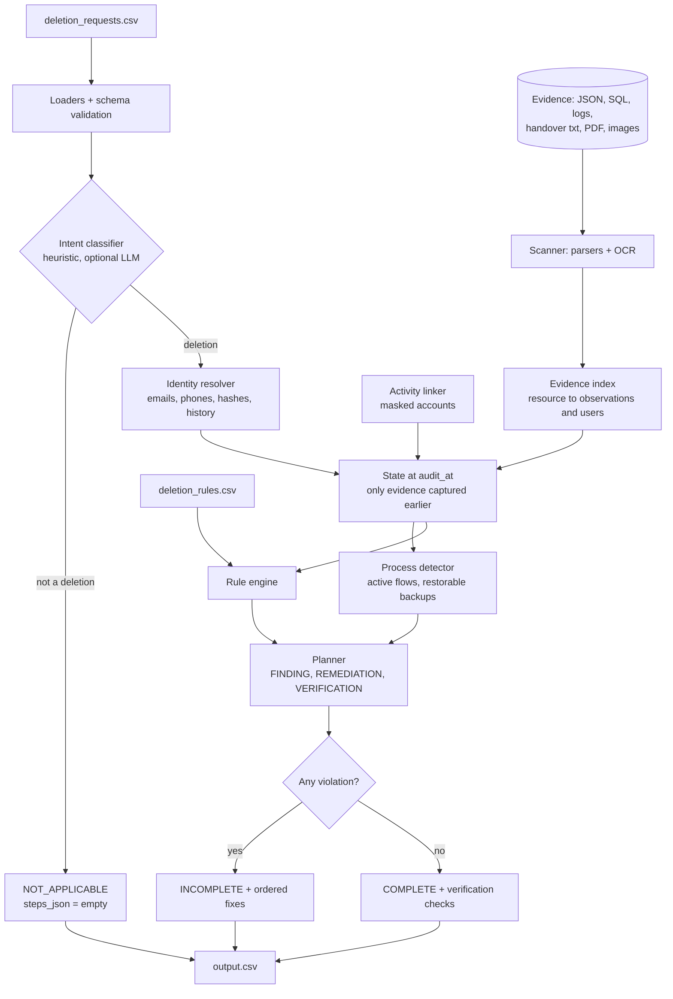

# Ghost Data Still Exists — AI Deletion Audit Agent

Northstar Shop lost $2.4M after a "deleted" customer reappeared: dashboards said *Complete*, yet personal
data survived in secondary databases, support attachments, search indexes, analytics exports, logs, archives and
backups — and a sync job re-created data the account service had deleted.

This agent **proves** whether a person's data is really gone. For each request it decides
`COMPLETE | INCOMPLETE | NOT_APPLICABLE`, resolves identity (current and historical), lists every exposing
record and recreate path, and emits an **ordered** remediation/verification plan (`output.csv`).

## Flow



## Approach

* **Hybrid, deterministic first.** Parsers, identity matching, rules and ordering are plain code. An LLM is only
  consulted for ambiguous request text and only when a key is configured (`.env`); otherwise the run is fully
  deterministic and makes zero LLM calls. Images are read with local OCR (RapidOCR), PDFs with pypdf.
* **Rule engine, no hardcoded rules.** `deletion_rules.csv` is parsed into Delete/Redact/Anonymize/Retain treatments
  that map to remediation and verification operations.
* **Point-in-time.** Only evidence captured at or before `audit_at` is used; the riskiest state across replicas wins.
* **Ordering.** FINDING → REMEDIATION → VERIFICATION; inside remediation, recreate paths are stopped
  (`DISABLE_DATA_FLOW`, `BLOCK_RESTORE`) before any delete/redact/anonymize, per the contract's operation order.
* **Explainable.** Findings and COMPLETE verifications cite the `evidence_id`; per-case structured logs list the
  evidence used.

See [docs/DECISIONS.md](docs/DECISIONS.md) for rationale.

## Layout

```
code/ghost_audit/  loaders/ identity/ rules/ scanner/ processes/ reasoner/ planner/ agent.py
code/cli.py        run command
code/evaluation/   run.py, evaluation_report.md, usage_report.md
code/tests/        unit tests
configs/default.yaml  .env.example  Makefile  scripts/make_zip.py
```

## Run

> `dataset/` is supplied by the organisers and is git-ignored. The package is named `code/`, which collides with
> Python's stdlib module, so `python -m code.cli` cannot work; use the script path below.

```bash
make setup
python code/cli.py run --input dataset/deletion_requests.csv --output output.csv
python code/evaluation/run.py --config configs/default.yaml
python -m pytest code/tests -q
python scripts/make_zip.py
```

## Evaluation (32 labelled samples, rules-only)

* Status accuracy 93.8% (COMPLETE recall 1.00, INCOMPLETE recall 0.91).
* Exposed-record precision 1.00 / recall 0.94; recreate-path precision and recall 1.00.
* Ordered-step LCS 0.90, Kendall tau 1.00, exact sequence match 72%.
* Activity-stream linking improves exact sequence match from 28% to 72% (accounts, plus masked analytics copies for otherwise-clean cases).

Full tables, confusion matrix and every mismatch: `code/evaluation/evaluation_report.md`.

## Limitations

* Masked analytics/support rows with no identifier cannot be tied to a person from evidence alone.
* Account linking from the activity stream is a timing heuristic and can pick a neighbouring case's account.
* The evidence-id choice for COMPLETE cases is approximate; OCR/PDF parsing is heuristic.
* NOT_APPLICABLE has no labelled example in the samples, so it is validated only by custom cases.

## Future work

Use a VLM for screenshots, an LLM tie-breaker for ambiguous identity links, learned evidence-id selection, and
per-request confidence scores.

